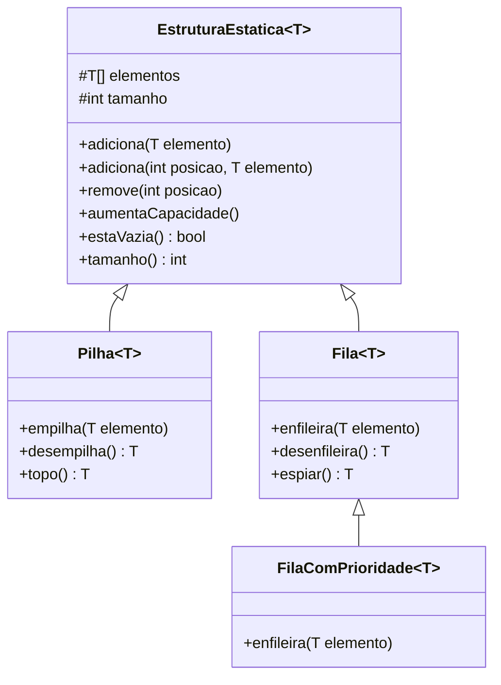

# Estrutura de Dados em Java


Implementações de estruturas de dados clássicas em Java, desenvolvidas durante o curso de [Estrutura de Dados da Loiane Groner](https://loiane.training/). O projeto aplica conceitos de **arrays dinâmicos**, **generics**, **herança** e **polimorfismo** para construir as estruturas do zero.

---

## Estruturas Implementadas

| Estrutura           | Classe Principal        | Operações                                   | Status |
|---------------------|-------------------------|---------------------------------------------|--------|
| Vetor (String)      | `Vetor.java`            | adiciona, busca, remove, expansão auto      | ✅ |
| Vetor (Genérico)    | `ListaVetor.java`       | adiciona, busca, remove, expansão auto      | ✅ |
| Vetor (Object)      | `VetorObject.java`      | versão sem generics                         | ✅ |
| Pilha               | `Pilha<T>`              | empilha, desempilha, topo                   | ✅ |
| Fila                | `Fila<T>`               | enfileira, desenfileira, espiar             | ✅ |
| Fila com Prioridade | `FilaComPrioridade<T>`  | enfileira ordenado por Comparable           | ✅ |
| Lista Encadeada     | `ListaEncadeada.java`   | —                                           | 🚧 |

---

## Hierarquia de Classes



---

## Como Cada Estrutura Funciona

### Vetor Dinâmico
Array que **dobra de capacidade** automaticamente quando cheio, sem o programador precisar gerenciar memória manualmente.

```
Capacidade inicial: 10
Ao atingir limite → nova capacidade: 20 → 40 → 80...
```

### Pilha (LIFO)
```
empilha(A) → [A]
empilha(B) → [A, B]
empilha(C) → [A, B, C]
desempilha()  → retorna C → [A, B]
topo()        → retorna B (sem remover)
```

### Fila (FIFO)
```
enfileira(A) → [A]
enfileira(B) → [A, B]
enfileira(C) → [A, B, C]
desenfileira() → retorna A → [B, C]
espiar()       → retorna B (sem remover)
```

### Fila com Prioridade
Ao enfileirar, percorre a fila e insere o elemento na posição correta de acordo com a ordem natural (`Comparable`), mantendo a fila sempre ordenada.

---

## Estrutura do Projeto

```
src/com/loiane/estruturadados/vetor/
├── base/
│   └── EstruturaEstatica.java     # Classe base genérica (array dinâmico)
├── vetor/
│   ├── Vetor.java                 # Vetor de String com expansão automática
│   ├── VetorObject.java           # Vetor de Object (sem generics)
│   ├── ListaVetor.java            # Vetor genérico
│   └── testeVetor/
│       ├── TesteAula02..12.java   # Testes progressivos por aula
│       ├── Exerc01..07.java       # Exercícios
│       ├── Contato.java           # Modelo usado nos exercícios
│       └── TesteAgenda.java       # Agenda de contatos
├── pilha/
│   ├── Pilha.java                 # Pilha genérica (LIFO)
│   ├── ListaVetorPilha.java       # Variação com lista
│   ├── testePilha/
│   │   └── Aula13..18.java        # Testes por aula
│   └── exercicios/
│       ├── Exerc01..08.java       # Exercícios de pilha
│       └── Livro.java             # Modelo usado nos exercícios
├── fila/
│   ├── Fila.java                  # Fila genérica (FIFO)
│   ├── FilaComPrioridade.java     # Fila ordenada por Comparable
│   └── testeFila/
│       ├── Aula19..24.java        # Testes por aula
│       ├── Paciente.java          # Modelo: fila de prioridade hospitalar
│       ├── Classe1.java
│       └── Interface1.java
└── lista/
    └── ListaEncadeada.java        # 🚧 Em andamento
```

---

## Como Executar

**Pré-requisitos:** Java JDK 11 ou superior e uma IDE Java ([IntelliJ IDEA](https://www.jetbrains.com/idea/), Eclipse ou VS Code).

1. Clone o repositório:
   ```bash
   git clone https://github.com/odavid062/Estrutura-de-Dados.git
   ```

2. Abra no IntelliJ IDEA (ou qualquer IDE Java)

3. Navegue até o arquivo que deseja testar e execute como Java Application:
   - Vetor → `testeVetor/TesteAula12.java`
   - Pilha → `testePilha/Aula18.java`
   - Fila → `testeFila/Aula24.java`
   - Pilha (exercícios) → `exercicios/Exerc08.java`

---

## Conceitos Aplicados

- **Generics** (`<T>`) — estruturas reutilizáveis para qualquer tipo
- **Herança** — `Pilha` e `Fila` estendem `EstruturaEstatica`
- **Polimorfismo** — `FilaComPrioridade` sobrescreve `enfileira()`
- **Comparable** — ordenação automática na fila de prioridade
- **Expansão dinâmica** — array dobra de tamanho quando necessário
- **LIFO / FIFO** — princípios fundamentais de pilha e fila

---

## Referências

- [Curso Estrutura de Dados - Loiane Groner](https://loiane.training/)
- [Java Generics - Oracle Docs](https://docs.oracle.com/javase/tutorial/java/generics/)

---

## Autor

**David Rodrigues** — [GitHub](https://github.com/odavid062) · [LinkedIn](https://www.linkedin.com/in/david-rodrigues-00b988214)
